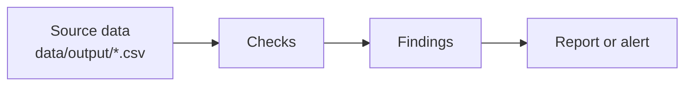

# CRM Silent-Failure Monitor

A scheduled job that finds CRM records which break pipeline and revenue reports without raising an error, and reports what is new, resolved or unchanged since the last run.

> **Using this template.** Click "Use this template" on GitHub, then run `make setup` and `make test`. Replace every section below with your project's content and delete the italic guidance. The `/case-study` command in Claude Code can draft these sections from the code and decision log.

## Demo


*Record a GIF of 30 seconds or less showing the tool running on the demo data: the command, the output, and the one thing a viewer should notice. Save it as `docs/demo.gif`.*

## Problem

*Who has the problem, what goes wrong, and what it costs them. Two or three short paragraphs. Use the fictional company (Northwind Analytics) as the setting.*

## Data

This project uses synthetic data for Northwind Analytics, a fictional B2B SaaS company. `make demo` writes it to `data/output/`:

| File | Rows (scale 1) | Contents |
|---|---|---|
| `owners.csv` | 12 | sales reps, two of them inactive |
| `companies.csv` | 200 | customer accounts, 12% churned |
| `contacts.csv` | ~1,000 | people at those companies |
| `deals.csv` | ~600 | open and closed deals |
| `usage_events.csv` | ~20,000 | daily product usage for the last 60 days |
| `support_tickets.csv` | ~1,500 | support requests |

With `--defects`, the generator plants 23 known data-quality problems and lists the affected records in `defects_manifest.json`. See [data/DEFECTS.md](data/DEFECTS.md).

*Say which tables and defects this project uses.*

## Architecture



*Replace the diagram with the real components. Keep it to the parts a reader needs to follow the Approach section.*

## Approach

*The steps the code takes, in order, and the main design choices. Link to `docs/decisions.md` for the reasoning instead of repeating it.*

## Results

*Numbers from a real run, with the command that produced them. For example: defects found vs. planted, false positives on clean data, run time. If something doesn't work yet, say so.*

## How to run

Requires [uv](https://docs.astral.sh/uv/) and GNU make. uv installs Python 3.12 if it isn't present.

```
make setup   # install Python 3.12, dependencies and the git hook
make test    # run the tests
make demo    # run the monitor on two simulated days and open reports/latest.html
```

Run `make help` for every target. Setup details and troubleshooting are in [docs/runbook.md](docs/runbook.md).

## How I built this

*Be specific about who did what. Reviewers want to know which judgement calls were yours.*

**What I decided**

- *Scope: which problem, which defects, what was left out and why.*
- *Rules: the business rules the checks enforce.*
- *Trade-offs: for example, stdlib only, CSV instead of a database.*

**What Claude Code did**

- *Scaffolding, boilerplate and config.*
- *First drafts of code and tests, from my plan in `docs/plan.md`.*
- *Refactors and fixes I asked for.*

**How I checked its work:** *for example, read every diff, reviewed the defect detection rules, ran the tests and the demo before each commit.*

## Decisions

Design decisions and their reasons are logged in [docs/decisions.md](docs/decisions.md).

## Limitations

*What this doesn't handle, known false positives, and what you would do next.*
