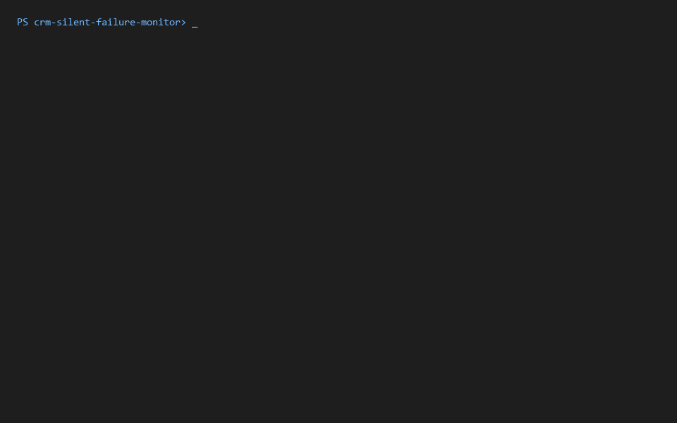
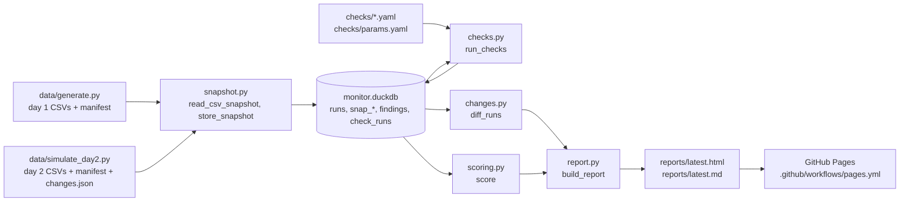
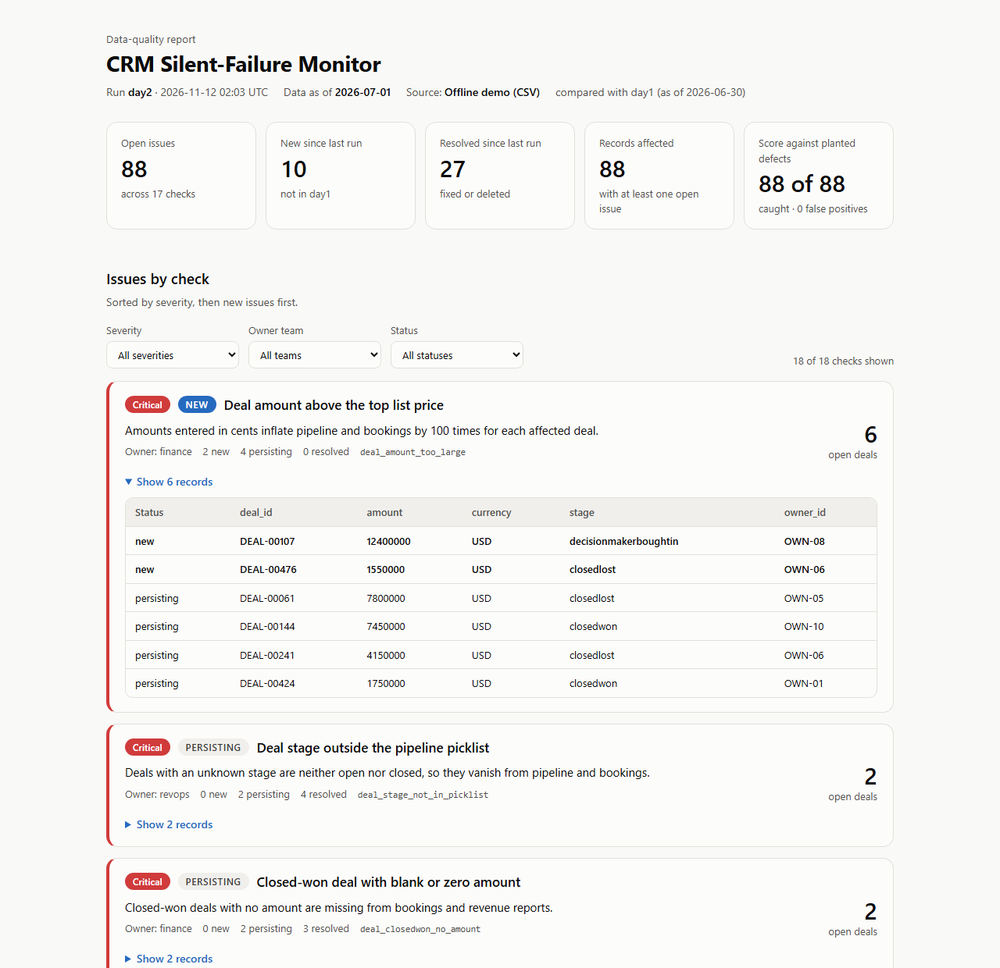

# CRM Silent-Failure Monitor

A job that snapshots CRM data, runs SQL checks for records that break pipeline and revenue reports without raising an error, and reports what is new, resolved or unchanged since the last run.

**Latest report:** https://hamedmahmo.github.io/crm-silent-failure-monitor/ (the offline demo, rebuilt on every push to `main`).

Status: milestones 1-3 are built and run offline on synthetic data. Milestone 4 seeded a HubSpot developer test account on 2026-11-12: 203 companies, 1,031 contacts and 570 deals, with 75 planted records in the 12 defects HubSpot accepts. Milestone 5, which reads the test account back and runs the checks on it, is built and tested against a mocked HubSpot API but hasn't been run against the portal yet. The digest and the scheduled job are planned in [docs/plan.md](docs/plan.md) and not built yet.

## Demo



`make demo` prints one summary and one score line per day. The day-2 report then opens; with the Status filter set to "New", it shows the 5 checks that have issues not present on day 1, and each card's sample table lists the new records first.

## Problem

Northwind Analytics, a fictional B2B SaaS company, runs its pipeline and revenue reports from a CRM. Most bad data doesn't cause an error anywhere. A closed-won deal with no amount still saves; it just drops out of bookings. A deal whose stage is `Closed Won` instead of the picklist value `closedwon` is neither open nor closed, so it disappears from both the pipeline and the bookings report. A contact created after the attribution cutoff with no source makes channel reports look worse than they are.

Nobody finds these problems until a number in a meeting looks wrong, and then someone has to work backwards from the report to the records. The monitor checks the records directly, on every run, and says which records are wrong, which team owns the fix, and whether the problem is new since the last run or has been there for a while.

## Data

All data is synthetic. `data/generate.py` (from the portfolio template) builds Northwind with a fixed seed and plants 23 documented defects; `defects_manifest.json` lists every affected record. See [data/DEFECTS.md](data/DEFECTS.md).

The monitor reads four of the six tables:

| File | Rows on day 1 | Used |
|---|---|---|
| `owners.csv` | 12 | yes |
| `companies.csv` | 203 | yes |
| `contacts.csv` | 1,050 | yes |
| `deals.csv` | 581 | yes |
| `usage_events.csv` | 21,270 | no |
| `support_tickets.csv` | 1,528 | no |

17 of the 23 defects are in scope: D01-D04, D06-D10 and D16-D23, which plant 105 records. D05 and D11-D15 involve usage events or support tickets and are left for a later project.

`data/simulate_day2.py` builds a second snapshot one day later from the day-1 output. It applies a fixed story: 22 issues fixed in place, 5 duplicate records merged away, 10 new issues from a broken web form and a bad import, and some ordinary edits that must not be flagged (5 new contacts, 3 deals moved to a later stage, 1 deal closed won). It writes `changes.json`, which the tests use as the expected answer.

## Architecture



`monitor/pipeline.py` runs one snapshot through these steps; `monitor/cli.py` provides `python -m monitor run` and `python -m monitor demo`.

## Approach

1. **Snapshot.** Each CSV folder becomes a new run in DuckDB. Values are stored as text exactly as read, with only empty strings turned into NULL, so defects like `closedwon ` with a trailing space survive.
2. **Checks.** 18 checks live in `checks/companies.yaml`, `checks/contacts.yaml` and `checks/deals.yaml`. Each has an owner team, a severity, a one-line "why it matters", the defect IDs it targets and a SQL query that returns record IDs. The SQL runs against views of the current run plus `run_context` (as-of date and thresholds) and `deal_stages` (the picklist). A check that fails is recorded as an error and the others still run.
3. **Change detection.** Findings are compared with the previous run: new, persisting, or resolved (fixed, or deleted when the record is gone). Findings of a check that errored are never counted as resolved. Records are compared too: added, removed, changed.
4. **Scoring.** When the snapshot has a `defects_manifest.json`, each check's findings are compared with the planted records of its defects and record type: caught, missed, false positives.
5. **Report.** One report model is rendered with Jinja2 into markdown and a single self-contained HTML page: summary tiles, one card per check sorted by severity and then new first, filters by severity, owner team and status, sample records, light and dark mode, and a print layout.

The reasons for these choices are in [docs/decisions.md](docs/decisions.md).

## Results

From `make demo` (seed 42), run on 2026-11-11:

```
day1 (as of 2026-06-30): 105 open issues in 18 checks: 105 new, 0 persisting, 0 resolved (no previous run)
  caught 105 of 105 planted records, 0 false positives
day2 (as of 2026-07-01): 88 open issues in 17 checks: 10 new, 78 persisting, 27 resolved
  caught 88 of 88 planted records, 0 false positives
```

- Day 1: all 105 planted records in scope were found, with no false positives.
- Day 2: the 10 new and 27 resolved findings match `data/output/day2/changes.json` exactly (22 fixed plus 5 deleted). The record diff matches too: deals had 2 added, 0 removed and 21 changed.
- Clean data (`uv run python data/generate.py` without `--defects`, then `uv run python -m monitor run --path <folder>`): `0 open issues in 0 checks`. This includes contacts with a blank source created before the 2026-01-01 cutoff and early-stage deals with no amount, which are allowed.
- `make demo` took 3.6 seconds (wall clock) on the Windows 11 development machine. `make test` ran 214 tests in 40 seconds.

The day-2 report (`reports/latest.html`):



These numbers show the checks match the rules in `data/DEFECTS.md`; the checks were written knowing those rules, so they don't show how the monitor does on defects it wasn't designed for.

## How to run

Requires [uv](https://docs.astral.sh/uv/) and GNU make. uv installs Python 3.12 if it isn't present.

```
make setup   # install Python 3.12, dependencies and the git hook
make test    # run the tests
make demo    # run the monitor on two simulated days and open reports/latest.html
```

To run the monitor on one snapshot folder: `uv run python -m monitor run --path data/output/day1`. Run `make help` for every target. Options, outputs and troubleshooting are in [docs/runbook.md](docs/runbook.md).

## How I built this

**What I decided**

- The goal and scope: a monitor for silent CRM failures, limited to owners, companies, contacts and deals, with usage events and support tickets left for a later project.
- The check format: one YAML entry per check with owner team, severity, target defects and SQL returning record IDs, so adding a check means adding one entry.
- Scoring every run against the defect manifest, and requiring the clean-data traps to stay unflagged.
- Simulating two runs offline so change detection can be tested without an API.
- The report brief: a polished, self-contained page rendered with Jinja2, summary tiles, one card per check with a "why it matters" line, filters, WCAG AA colours, light and dark mode, print layout.
- The milestone order, with a plan review before any code and a stop before any HubSpot call.
- For the HubSpot milestones: a service key from the environment, idempotent seeding keyed on a `northwind_id` property, a reset that only deletes tagged records, shifting dates and storing the original create date in `northwind_created_at`, and mapping every sample owner to one HubSpot user.
- Publishing the latest report on GitHub Pages.

**What Claude Code did**

- Wrote the plan in `docs/plan.md` for review, including the D17 split into two checks with record-type scoring, text-only storage, and the day-2 story.
- Wrote the tests before the code in each milestone, then the code: snapshot loader, check engine, the 18 checks, scoring, change detection, day-2 simulator, report templates and CLI.
- Proposed the severities and owner teams in the check YAML.
- Picked the report colours from a fixed status palette, computed their contrast, and checked the page with headless Chrome in light and dark mode, at 375 px wide and as a print PDF.
- Wrote the GitHub Pages workflow and made the report screenshot and the demo GIF from a real `make demo` run.
- Wrote the decision entries, the runbook and the first draft of this README.

**How I checked its work:** I reviewed and approved the plan in `docs/plan.md` before any monitor code was written, and Claude Code brought open design questions back to me instead of settling them itself; the HubSpot date shift and owner mapping were decided that way on 2026-11-11. The definition of done in `CLAUDE.md` sets the bar for each change: tests written first, `make test`, `make lint` and `make hooks` passing, and `make demo` catching every planted record with 0 false positives on both days while clean data gives none. CI runs the same targets on Linux, and I merged the milestone 1-3 pull request after it passed there. For milestone 4, Claude Code stopped before every live HubSpot step and waited for my go-ahead. The first probe run showed that HubSpot rejects `.example` emails; it stopped there, before seeding, and I chose the `.example.com` fix from the options it laid out. After the seed, a second run created 0 records and the answer key scored 75 of 75 with 0 false positives.

## Decisions

Design decisions and their reasons are logged in [docs/decisions.md](docs/decisions.md).

## Limitations

- Reading the HubSpot test account (milestone 5) has only run against a mocked API so far; the digest and the scheduled run (milestones 6-7) are not built.
- Data sent to HubSpot uses `.example.com` emails and domains instead of `.example`, because HubSpot rejects the `.example` top-level domain.
- The checks are exact rules for the planted defects. Duplicate detection only catches emails that differ by letter case or surrounding spaces, and companies with the same domain; it doesn't do fuzzy name matching.
- The stale-stage check (D21) needs a `stage_entered_at` value. HubSpot's own stage-entry properties are read-only, so seeded deals carry it in a custom property, `northwind_stage_entered_at`. Deals added by hand in HubSpot don't have it, so D21 can't flag them.
- The database keeps every snapshot and has no pruning yet.
- The status filter works on whole checks: "Resolved" shows only checks with no open findings left. Partly resolved checks show their resolved count on the card.
- Scoring is only meaningful where a defect manifest exists, which is the synthetic data. A real portal has no answer key.
